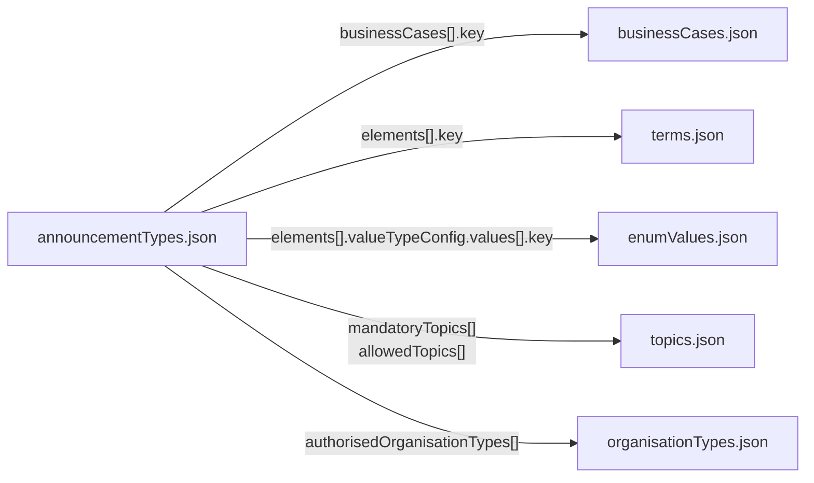

# ePublication configuration

This repository contains the master announcement types of ePublication and the catalogs of business cases, elements, selection values (enums), topics and organisation types that they are built from.

The master announcement types are defined by the provider. Editors adopt them for their gazettes and adapt them where needed.

> [!NOTE]
> The principle behind the master announcement types (the roles of provider, editor and publishing entity, and a glossary of the main terms) is explained in the [ePublication overview](https://github.com/epublication/epublication).
>
> There is no public API for the master announcement types. They can only be changed by the provider, and the same applies to the catalogs they are built from. The adaptations that editors make for their own gazettes are not part of this repository. Further informations on the public API can be found in the [API repository](https://github.com/epublication/epublication-api).

## Contents

| File | Content |
|---|---|
| [`announcementTypes.json`](announcementTypes.json) | Catalog of master announcement types: one entry per announcement type with its business cases, content elements, topics and publication settings |
| [`terms.json`](terms.json) | Announcement element catalog: every element with its value type |
| [`businessCases.json`](businessCases.json) | Catalog of business cases |
| [`enumValues.json`](enumValues.json) | Catalog of selection values used in selection lists |
| [`topics.json`](topics.json) | Catalog of topics |
| [`organisationTypes.json`](organisationTypes.json) | Catalog of organisation types |
| [`meta.json`](meta.json) | Export date and version of this configuration |

## How the files fit together

`announcementTypes.json` is the core of the configuration. Each announcement type refers to entries in the other catalogs by their key:

The catalogs define the keys and their meaning. Where the display labels are kept differs between the catalogs:

- **Business cases, elements and selection values (enums)** have only a key and a description in their catalog. Their labels are defined in each announcement type. The same key can therefore appear under different labels: the business case `application`, for example, is labelled «Baugesuch» (building permit application) in one announcement type and «Einbürgerungsgesuch» (naturalisation application) in another.
- **Topics and organisation types** carry their labels in the catalog itself, so they have the same label wherever they are used.

## Conventions

- **Keys** are technical identifiers such as `generalNotice` or `primaryEntityLegalPerson`. All references between the files use these keys.
- **Multilingual texts** are objects with the keys `de`, `fr`, `it` and `en`.
- **Descriptions in the catalogs** (`terms.json`, `businessCases.json`, `enumValues.json`, `topics.json`) are in English only and explain the meaning of an entry. Texts in `announcementTypes.json` are multilingual.
- **File structure:** each catalog file contains one object with a single array named after the file, for example `{ "topics": [ … ] }`.
- **Encoding and formatting:** UTF-8, Unix line endings, indented with two spaces.

## `announcementTypes.json`

### Master announcement type

| Field | Type | Description |
|---|---|---|
| `announcementTypeId` | string | ID of the announcement type, e.g. `"402"` |
| `name` | multilingual | Name of the announcement type |
| `description` | multilingual | Description of the announcement type |
| `legalBasis` | multilingual | Legal basis, as text or as a link (e.g. to Fedlex) |
| `authorisedOrganisationTypes` | string[] | Organisation types that may publish announcements of this type, see [`organisationTypes.json`](#organisationtypesjson) |
| `businessCases` | object[] | Business cases of this announcement type, see [Business cases](#business-cases) |
| `elements` | object[] | Content elements of this announcement type, see [Elements](#elements) |
| `mandatoryTopics` | string[] | Topics that are always assigned to announcements of this type, see [`topics.json`](#topicsjson) |
| `allowedTopics` | string[] | Further topics that the publishing entity can add. Mandatory topics are not repeated here. |
| `publicityPeriod` | object | Publicity period in days: `defaultValue`, `min` and `max` |
| `livePublication` | boolean | Whether announcements of this type can be published immediately |
| `allowedPublicationDays` | string[] | Weekdays on which announcements can be published: `mon`, `tue`, `wed`, `thu`, `fri`, `sat`, `sun` |
| `exclusivePrimaryGazetteTypes` | string[] | Levels of gazettes in which this type can be used as the primary gazette: `FEDERAL`, `CANTONAL`, `REGIONAL`, `MUNICIPAL` |
| `price` | string | Price of an announcement, as a decimal number |
| `apiDiscount` | string | Discount for announcements submitted via the API |
| `allowGeneratePDF` | boolean | Whether a PDF can be generated for announcements of this type |
| `allowAccessViaInterface` | boolean | Whether announcements of this type can be submitted via the API |
| `affectedRegionType` | string | Kind of affected region: `municipal`, `cantonal` or `byContent` |
| `setDefaultAffectedRegion` | boolean | Whether the affected region is pre-filled |

### Business cases

Each entry in `businessCases` describes one business case of the announcement type.

| Field | Type | Description |
|---|---|---|
| `key` | string | Key of the business case, see [`businessCases.json`](#businesscasesjson) |
| `label` | multilingual | Label of the business case in this announcement type. It is shown first in the announcement title. |
| `description` | multilingual | Description of the business case |
| `hasLegalBlock` | boolean | Whether announcements of this business case contain a legal notice |
| `legalNoticeDefault` | object | Present if `hasLegalBlock` is `true`. Contains `label` and `description` of the legal notice and, optionally, a `defaultText` (multilingual) |
| `setContactDefault` | boolean | Whether a contact is pre-filled |
| `deadlines` | object[] | Deadlines of the business case, see below. Can be empty. |

Each deadline has a `label`, a `description` and a `deadlineDefault`:

| Field | Type | Description |
|---|---|---|
| `deadlineDefault.type` | string | How the deadline is specified: `DATE`, `DAYS`, `MONTHS` or `DURATION` |
| `deadlineDefault.value` | string | Optional default for `DAYS` and `MONTHS`, e.g. `"30"` |

### Elements

Each entry in `elements` describes one content element of the announcement type.

| Field | Type | Description |
|---|---|---|
| `key` | string | Key of the element, see [`terms.json`](#termsjson). The element's value type follows from this key. |
| `label` | multilingual | Label of the element in this announcement type |
| `description` | multilingual | Help text for the element |
| `mandatory` | boolean | Whether a value is required |
| `multiple` | boolean | Whether more than one value can be entered |
| `isPartOfTitle` | boolean | Whether the value is used in the announcement title |
| `hiddenOnView` | boolean | Whether the element is hidden in the published announcement |
| `hideLabel` | boolean | Whether the value is shown without its label |
| `valueTypeConfig` | object | Optional settings that depend on the value type, see below |
| `defaultValue` | string | Optional default value. For selection lists, the key of a selection value. |

## `terms.json`

The announcement element catalog. Each entry has a `key`, a `valueType` and a `description`. The following ValueTypes are used:  

| Value type | Content |
|---|---|
| `string` | Text without language versions |
| `stringMultiLang` | Text with language versions |
| `textarea` | Longer text, can contain formatting |
| `date` | Date |
| `enum` | Selection from a list of values. The list is defined in each announcement type. |
| `url` | Link |
| `address` | Postal address according to the eCH-0010 standard |
| `person` | Natural or legal person |
| `naturalPerson` | Natural person |
| `legalPerson` | Legal person |
| `item` | Object or matter, e.g. the title of a spatial plan |
| `attachmentLinked` | Attachment that provides additional information relating to an announcement - for example a construction plan. |
| `attachmentEmbedded` | Attachment whose content is embedded in the generated Complete Issue PDF - for example a new document of legislation. |

## `businessCases.json`

Catalog of business cases. Each entry has a `key` and a `description`. A business case is a generic category such as `application`, `change` or `closing`. Its label is defined in each announcement type, see [How the files fit together](#how-the-files-fit-together).

## `enumValues.json`

Catalog of all selection values used in selection lists. Each entry has a `key` and a `description`. Which values a selection list offers, and with which labels, is defined in each announcement type.

## `topics.json`

Catalog of topics. Each entry has a `key`, a multilingual `label` and a `description`. Topic labels cannot be changed by editors.

## `organisationTypes.json`

Catalog of organisation types. Each entry has a `key` and a multilingual `label`. Announcement types refer to them in `authorisedOrganisationTypes`.

## `meta.json`

| Field | Type | Description |
|---|---|---|
| `date` | string | Date and time of the export (ISO 8601, UTC) |
| `version` | string | Version of the configuration |

## Versioning

Each export of the configuration is committed to this repository. `meta.json` shows the export date and version of the current state. The commit history of each file shows what changed between two exports.

## Further reading

The following articles in the ePublication Help Center are available in German:

- [Standardisierte Meldungstypen](https://helpcenter-epublication.zendesk.com/hc/de/articles/28970270476572-Standardisierte-Meldungstypen)
- [Kleines Glossar zum Meldungsstandard](https://helpcenter-epublication.zendesk.com/hc/de/articles/28970039873052-Kleines-Glossar-zum-Meldungsstandard)
- [Kataloge](https://helpcenter-epublication.zendesk.com/hc/de/articles/28970274717084-Kataloge)
